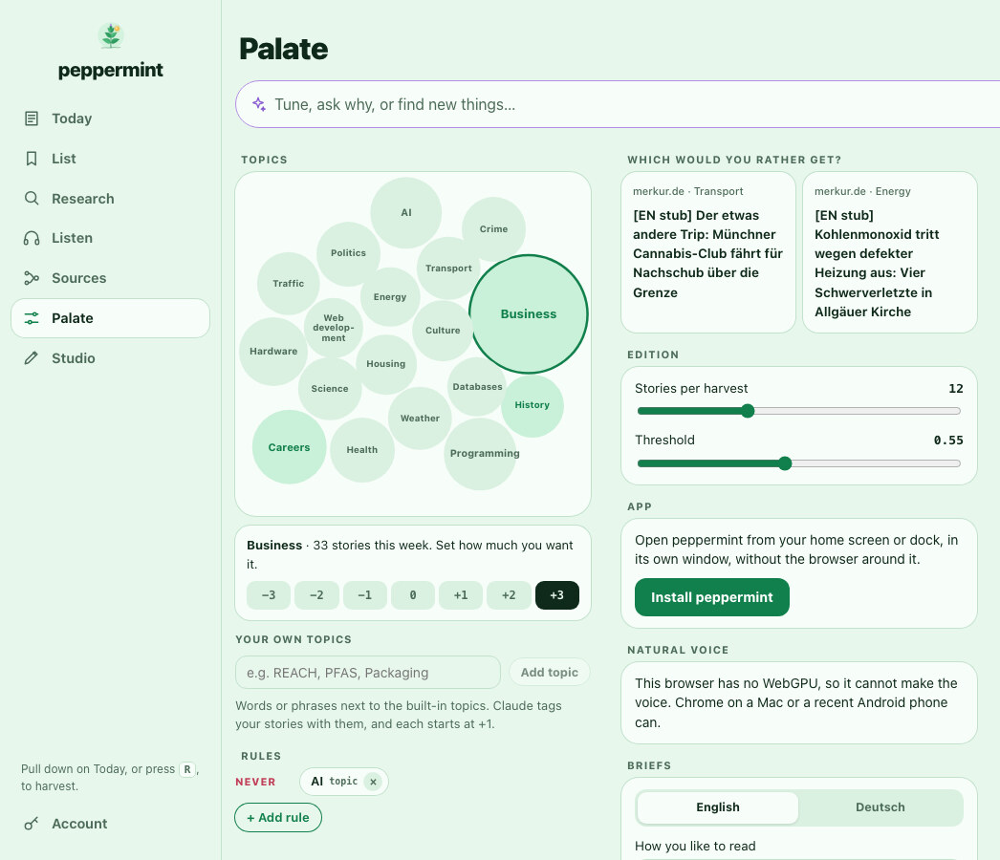

<div align="center">


# peppermint

</div>

A personal reader: everything you follow (feeds, podcasts, channels), tagged, clustered into stories and served as a
finite edition scored by your taste. For one reader or a small group who share a server, each with their own sources
and palate; passkeys only. Live at https://peppermint.kaleve.dev on kaleve-home (the laptop in
toolbox/home).



## Layout

| Path | What |
| --- | --- |
| `app/` | The whole app: Bun server (`server/`), Svelte client (`client/`), `shared/`, `tests/`. Its own README and `docs/backend.md` explain it. |
| `app/build.ts` | peppermint's part of the build; the shared rest is `app/tools/build-app.ts` (oss-kit's bun-app template). |
| `android/` | The Android app: the web app full screen, plus podcasts and the edition to listen to offline. `app/docs/android.md` explains it. |
| `app/deploy/` | `deploy.sh`, `nginx.sh`, the unit and `app.env`; `deploy/README.md` explains the template. |
| `tools/validate.sh` | Every check, the same script CI runs. |

## Run, check, deploy

```sh
cd app && bun install && bun run build && bun run start   # http://localhost:4317, prints a setup link on first start
tools/validate.sh                                         # frozen install, bun test --isolate, the client build
app/deploy/deploy.sh                                      # Linux binary to kaleve-home, restart, /healthz, public check
```

Several sessions work on `main` at once and deploy only from an up-to-date checkout: read `CLAUDE.md` first.
